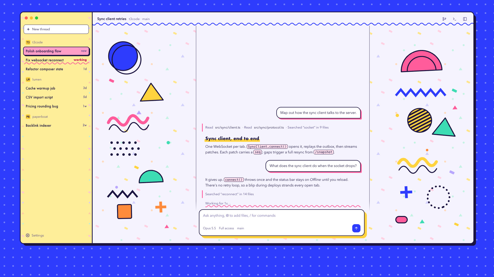

# Squiggle

**An 80s Memphis-style light theme for [T3 Code](https://t3.codes).** Confetti, squiggles and terrazzo sit in the margins and start to bob and tumble while your agent works. Idle is pastel and calm; the colour floods in while a turn runs, and a hop on the composer marks the end.

**[See it in motion →](https://joshsaintjacque.github.io/t3code-theme-squiggle/)**



## Install

**From the app**

1. Download [`squiggle.json`](squiggle.json), or copy its contents.
2. In T3 Code, open **Settings › Appearance › Add theme**.
3. Choose the file, or paste the JSON, and add it.

**From the terminal**

```sh
curl -fsSL -o squiggle.json https://joshsaintjacque.github.io/t3code-theme-squiggle/squiggle.json
~/.t3/bin/t3 theme set squiggle.json
```

Tested against T3 Code 0.1.11 (nightly).

## What moves, and when

Motion follows app state. If nothing is running, nothing moves.

| Trigger | Motion |
|---|---|
| Idle | Nothing moves. The margin collages are pastel. |
| Turn running | The saturated collages fade in over 0.7s: bobbing circles, tumbling shapes in the outer gutter, gently wiggling shapes beside the reading column, a spinning dotted ring. The composer floats on a yellow shadow and the header squiggle slides sideways. |
| Live *Working…* row, busy threads | A pink squiggle underline crawls. |
| Composer focus | The card lifts onto a pink shadow and unfolds a yellow dot and blue triangle from its corners. |
| Hover a thread | The row leans in with a springy ease. |
| Turn complete | The composer springs back from its yellow shadow (a transition, so it never plays on load) and the confetti fades back to pastel. |
| Window under 1460px | A slim one-column collage (gutters of 104px or more); the sidebar never carries art, so long thread lists stay clean. |

`prefers-reduced-motion` is respected: nothing animates; while a turn runs the margins swap to a still, saturated collage and the composer keeps its yellow shadow.

## Palette

Ink for every word, lemon for the sidebar, cobalt for actions, pink for focus and work in progress.

| Role | Hex |
|---|---|
| Canvas | `#f6f2ff` |
| Sidebar | `#ffee9a` |
| Message | `#ffffff` |
| Code block | `#d8f7eb` |
| Ink (text) | `#1b1340` |
| Muted | `#4f4380` |
| Accent | `#2f3cff` |
| Secondary | `#ffd23f` |
| Focus | `#ff2e88` |
| Update / Warning / Error | `#007d73` / `#b85c00` / `#d1003f` |

## Make your own variant

`squiggle.json` is generated. Edit [`source/build.py`](source/build.py) and run `python3 source/build.py`. The landing page is rendered by `python3 source/site.py`.

Not affiliated with T3. MIT licensed.
